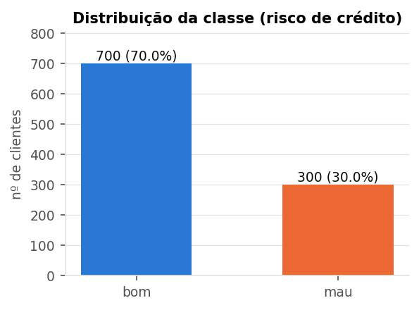
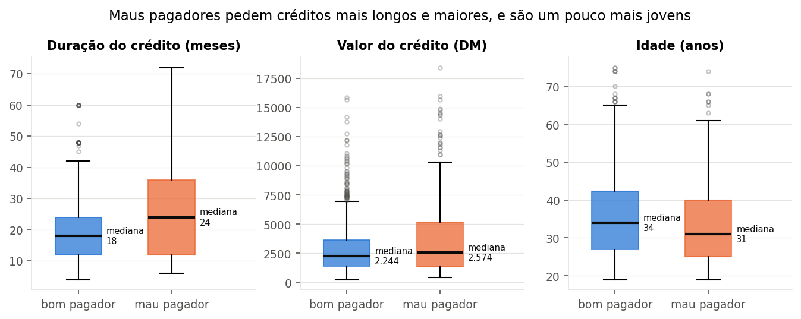
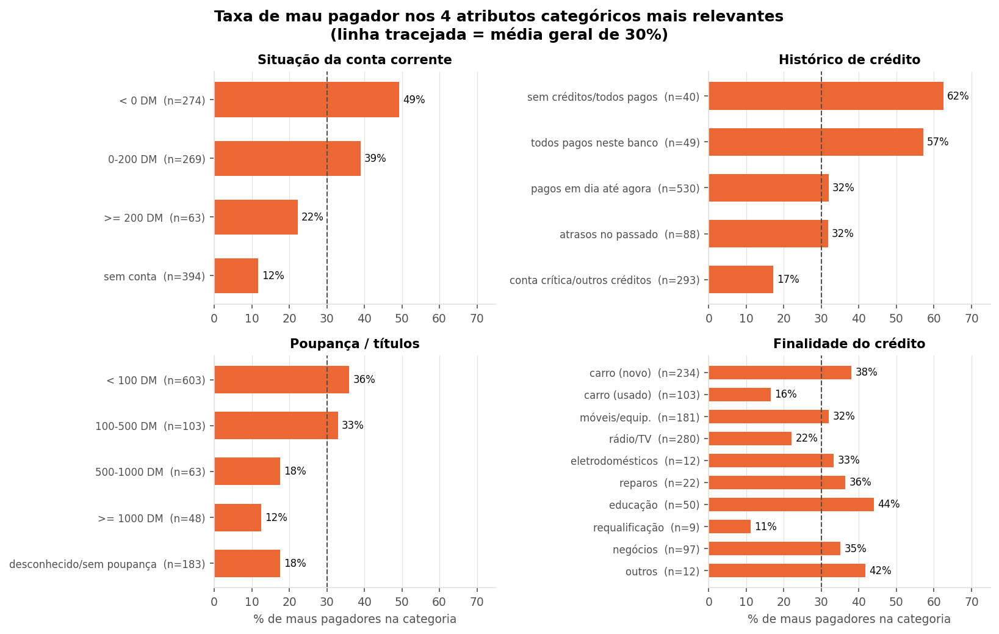
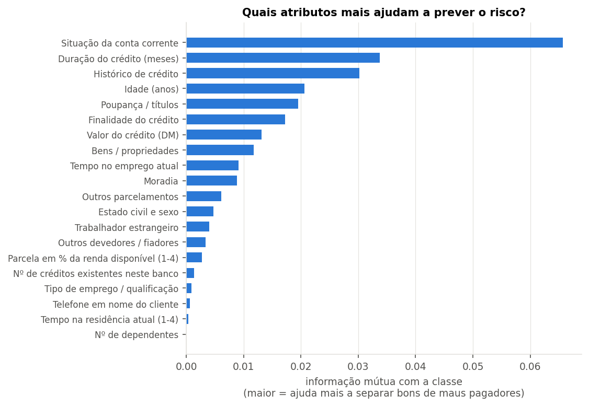
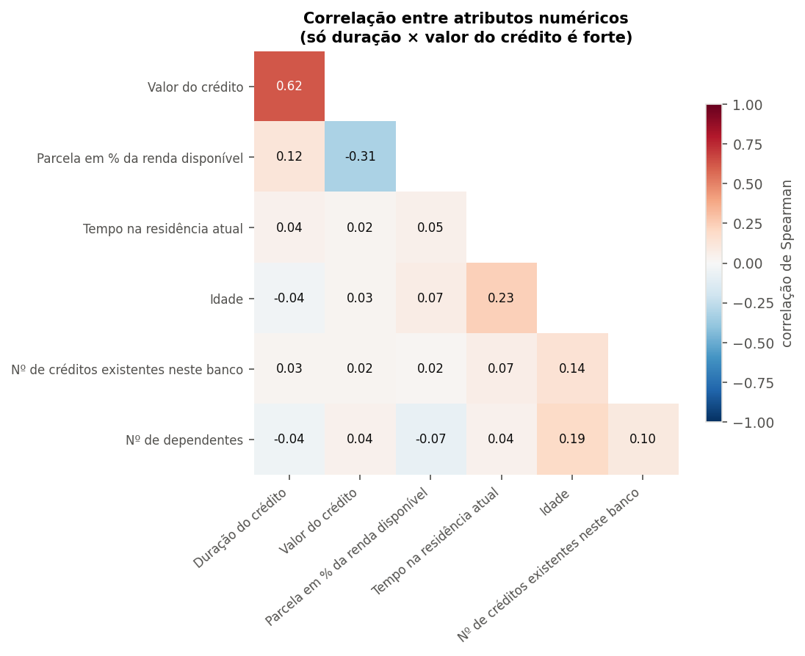

# Análise exploratória — Statlog (German Credit Data)

Fonte: UCI Machine Learning Repository — <https://archive.ics.uci.edu/dataset/144/statlog+german+credit+data>  
Doador: Prof. Dr. Hans Hofmann, Universität Hamburg (1994). Arquivo: `german.data`.

## 1. Problema

Classificação binária: dado o perfil de um solicitante de crédito, prever se ele é **bom** ou **mau** pagador. A base vem com uma **matriz de custo**: classificar um mau pagador como bom custa **5**, classificar um bom como mau custa **1**. Logo, a classe positiva de interesse é *mau* e o recall dessa classe importa mais que a acurácia.

## 2. Visão geral

- Instâncias: **1000**
- Atributos preditores: **20** (7 numéricos, 13 categóricos)
- Atributo classe: `credit_risk` (original 1=bom, 2=mau; recodificado para 0=bom, 1=mau)

| atributo | descrição | tipo | n_valores_distintos | ausentes |
|---|---|---|---|---|
| checking_status | Situação da conta corrente | categórico ordinal* | 4 | 0 |
| duration | Duração do crédito (meses) | numérico | 33 | 0 |
| credit_history | Histórico de crédito | categórico nominal | 5 | 0 |
| purpose | Finalidade do crédito | categórico nominal | 10 | 0 |
| credit_amount | Valor do crédito (DM) | numérico | 921 | 0 |
| savings_status | Poupança / títulos | categórico ordinal* | 5 | 0 |
| employment | Tempo no emprego atual | categórico ordinal | 5 | 0 |
| installment_rate | Parcela em % da renda disponível (1-4) | numérico discreto | 4 | 0 |
| personal_status | Estado civil e sexo | categórico nominal | 4 | 0 |
| other_parties | Outros devedores / fiadores | categórico nominal | 3 | 0 |
| residence_since | Tempo na residência atual (1-4) | numérico discreto | 4 | 0 |
| property | Bens / propriedades | categórico nominal | 4 | 0 |
| age | Idade (anos) | numérico | 53 | 0 |
| other_installment_plans | Outros parcelamentos | categórico nominal | 3 | 0 |
| housing | Moradia | categórico nominal | 3 | 0 |
| existing_credits | Nº de créditos existentes neste banco | numérico discreto | 4 | 0 |
| job | Tipo de emprego / qualificação | categórico ordinal | 4 | 0 |
| num_dependents | Nº de dependentes | numérico discreto | 2 | 0 |
| own_telephone | Telefone em nome do cliente | categórico nominal | 2 | 0 |
| foreign_worker | Trabalhador estrangeiro | categórico nominal | 2 | 0 |

\* ordinal exceto a categoria "sem conta"/"desconhecido", que não tem posição natural na escala.

## 3. Distribuição da classe

| classe | n | % |
|---|---|---|
| bom | 700.0 | 70.0 |
| mau | 300.0 | 30.0 |

Razão bom:mau = **2.33:1** → desbalanceamento moderado. Um classificador que responde sempre "bom" já tem 70% de acurácia, por isso acurácia sozinha não serve como métrica. Usar estratificação nas divisões treino/validação/teste e métricas como F1/recall da classe *mau*, AUC-ROC e custo total.

## 4. Qualidade dos dados

- Valores ausentes: **0**
- Linhas duplicadas: **0**
- Instâncias com mesmos atributos e rótulos diferentes: **0**
- Categorias documentadas que nunca aparecem: purpose=A47 (férias), personal_status=A95 (F solteira)
- Códigos não documentados: nenhum
- Checagens de domínio/consistência:

| checagem | ocorrências |
|---|---|
| duration <= 0 | 0 |
| credit_amount <= 0 | 0 |
| age < 18 | 0 |
| age > 100 | 0 |
| installment_rate fora de 1-4 | 0 |
| residence_since fora de 1-4 | 0 |
| job=desempregado(A171) e employment>=1 ano | 1 |
| employment=desempregado(A71) e job=qualificado/gerência | 45 |
| credit_history=sem créditos(A30) e existing_credits>1 | 27 |

Categorias raras (< 2% da base) — candidatas a agrupamento:

| atributo | categoria | rótulo | n | % |
|---|---|---|---|---|
| purpose | A44 | eletrodomésticos | 12 | 1.2 |
| purpose | A410 | outros | 12 | 1.2 |
| purpose | A48 | requalificação | 9 | 0.9 |

Observações:
- `personal_status` mistura sexo e estado civil; não existe a categoria "mulher solteira" (A95) na base, então sexo e estado civil não podem ser separados completamente. Esse atributo (e `foreign_worker`) é sensível do ponto de vista de justiça algorítmica.
- `foreign_worker` é quase constante (≈96% "sim").
- As checagens semânticas acusam casos *suspeitos*, mas não necessariamente erros: `employment`=desempregado com `job` qualificado pode indicar a qualificação profissional de alguém hoje sem emprego; A30 ("sem créditos / **todos pagos**") é ambígua no próprio dicionário, então ter mais de um crédito não a contradiz. Optamos por **não remover** essas linhas.
- `num_dependents` tem IQR = 0 (85% das linhas valem 1), por isso todos os valores 2 aparecem como "outliers" — artefato do método, não erro.

## 5. Atributos numéricos

| atributo | mean | std | min | 50% | max | assimetria | outliers_IQR | média_bom | média_mau |
|---|---|---|---|---|---|---|---|---|---|
| duration | 20.90 | 12.06 | 4.00 | 18.00 | 72.00 | 1.09 | 70.00 | 19.21 | 24.86 |
| credit_amount | 3271.26 | 2822.74 | 250.00 | 2319.50 | 18424.00 | 1.95 | 72.00 | 2985.46 | 3938.13 |
| installment_rate | 2.97 | 1.12 | 1.00 | 3.00 | 4.00 | -0.53 | 0.00 | 2.92 | 3.10 |
| residence_since | 2.85 | 1.10 | 1.00 | 3.00 | 4.00 | -0.27 | 0.00 | 2.84 | 2.85 |
| age | 35.55 | 11.38 | 19.00 | 33.00 | 75.00 | 1.02 | 23.00 | 36.22 | 33.96 |
| existing_credits | 1.41 | 0.58 | 1.00 | 1.00 | 4.00 | 1.27 | 6.00 | 1.42 | 1.37 |
| num_dependents | 1.16 | 0.36 | 1.00 | 1.00 | 2.00 | 1.91 | 155.00 | 1.16 | 1.15 |

- `credit_amount` tem forte assimetria à direita (cauda longa); `duration` e `age` também são assimétricas. Transformação log e/ou padronização ajudam modelos sensíveis à escala (MLP, KNN, SVM, regressão logística).
- Escalas muito diferentes (idade ~20-75 vs. valor até ~18 mil DM) → normalizar é obrigatório para a MLP.
- Os outliers por IQR são valores plausíveis (créditos altos e longos), não erros; não devem ser removidos.

## 6. Atributos categóricos

Gráfico dos 4 atributos categóricos mais associados à classe (os demais estão em `tables/06_frequencias_categoricos.csv`):

Categorias com maior taxa de mau pagador (n ≥ 30):

| atributo | categoria | n | %_mau |
|---|---|---|---|
| credit_history | sem créditos/todos pagos | 40 | 62.5 |
| credit_history | todos pagos neste banco | 49 | 57.1 |
| checking_status | < 0 DM | 274 | 49.3 |
| purpose | educação | 50 | 44.0 |
| other_parties | co-requerente | 41 | 43.9 |
| property | desconhecido/nenhum | 154 | 43.5 |

## 7. Associação com a classe

| atributo | tipo | teste | p_valor | medida_efeito | efeito | informação_mútua |
|---|---|---|---|---|---|---|
| checking_status | categórico | qui-quadrado | 0.0000 | Cramér's V | 0.3476 | 0.0657 |
| duration | numérico | Mann-Whitney U | 0.0000 | r ponto-bisserial (abs) | 0.2149 | 0.0337 |
| credit_history | categórico | qui-quadrado | 0.0000 | Cramér's V | 0.2403 | 0.0302 |
| age | numérico | Mann-Whitney U | 0.0004 | r ponto-bisserial (abs) | 0.0911 | 0.0206 |
| savings_status | categórico | qui-quadrado | 0.0000 | Cramér's V | 0.1792 | 0.0195 |
| purpose | categórico | qui-quadrado | 0.0001 | Cramér's V | 0.1561 | 0.0173 |
| credit_amount | numérico | Mann-Whitney U | 0.0059 | r ponto-bisserial (abs) | 0.1547 | 0.0131 |
| property | categórico | qui-quadrado | 0.0000 | Cramér's V | 0.1440 | 0.0118 |
| employment | categórico | qui-quadrado | 0.0010 | Cramér's V | 0.1199 | 0.0091 |
| housing | categórico | qui-quadrado | 0.0001 | Cramér's V | 0.1273 | 0.0088 |
| other_installment_plans | categórico | qui-quadrado | 0.0016 | Cramér's V | 0.1042 | 0.0062 |
| personal_status | categórico | qui-quadrado | 0.0222 | Cramér's V | 0.0813 | 0.0047 |
| foreign_worker | categórico | qui-quadrado | 0.0094 | Cramér's V | 0.0758 | 0.0040 |
| other_parties | categórico | qui-quadrado | 0.0361 | Cramér's V | 0.0682 | 0.0033 |
| installment_rate | numérico | Mann-Whitney U | 0.0199 | r ponto-bisserial (abs) | 0.0724 | 0.0028 |
| existing_credits | numérico | Mann-Whitney U | 0.1348 | r ponto-bisserial (abs) | 0.0457 | 0.0014 |
| job | categórico | qui-quadrado | 0.5966 | Cramér's V | 0.0000 | 0.0009 |
| own_telephone | categórico | qui-quadrado | 0.2488 | Cramér's V | 0.0181 | 0.0007 |
| residence_since | numérico | Mann-Whitney U | 0.9358 | r ponto-bisserial (abs) | 0.0030 | 0.0004 |
| num_dependents | numérico | Mann-Whitney U | 0.9242 | r ponto-bisserial (abs) | 0.0030 | 0.0000 |

- Significativos a 5% (15): checking_status, duration, credit_history, age, savings_status, purpose, credit_amount, property, employment, housing, other_installment_plans, personal_status, foreign_worker, other_parties, installment_rate
- Não significativos (5): existing_credits, job, own_telephone, residence_since, num_dependents
- Na informação mútua, os numéricos discretos (`installment_rate`, `residence_since`, `existing_credits`, `num_dependents`) são tratados como discretos; os contínuos usam o estimador por k-vizinhos.
- Nenhum atributo isolado separa bem as classes (maior Cramér's V ≈ 0,35): o problema é difícil e o ganho deve vir da combinação de atributos.

## 8. Correlações entre atributos

Pares com |ρ| ou V ≥ 0,3:

- `duration` × `credit_amount`: 0.62
- `property` × `housing`: 0.55
- `job` × `own_telephone`: 0.42
- `credit_amount` × `installment_rate`: -0.31
- `employment` × `job`: 0.31

Associação entre categóricos (Cramér's V) em `tables/09_cramers_v_categoricos.csv`.

## 9. Referências para a modelagem (matriz de custo FN=5, FP=1)

| classificador trivial | acurácia | custo_total | custo_médio |
|---|---|---|---|
| tudo 'bom' | 0.700 | 1500.000 | 1.500 |
| tudo 'mau' | 0.300 | 700.000 | 0.700 |

## 10. Implicações para o pré-processamento

1. **Sem ausentes/duplicatas** → não é preciso imputação nem remoção.
2. **Categóricos nominais** → one-hot encoding (MLP, KNN, SVM, reg. logística). Árvores podem usar códigos inteiros.
3. **Categóricos ordinais** (`employment`, `job`, `checking_status`, `savings_status`) → podem ser codificados ordinalmente, mas "sem conta"/"desconhecido" quebra a ordem; one-hot é a opção mais segura.
4. **Numéricos** → padronização (z-score); considerar log1p em `credit_amount` (e `duration`).
5. **Categorias raras** (ex.: `purpose` = requalificação/eletrodomésticos) → agrupar em "outros" para reduzir dimensionalidade e ruído no one-hot.
6. **Desbalanceamento 70/30 + custo assimétrico** → divisão estratificada treino/validação/teste, pesos de classe na loss (`weight_bias` na config) ou ajuste do limiar de decisão na validação; avaliar com recall/F1 da classe mau, AUC e custo.
7. **Base pequena (1000 linhas)** → MLP pequena, regularização (dropout/weight decay) e parada antecipada. Com conjuntos de validação/teste pequenos, repetir com várias seeds de divisão para medir a variabilidade.
8. Ajustar o pré-processamento (scaler, encoder) **apenas no treino**; validação e teste só recebem `transform`, para evitar vazamento de dados.